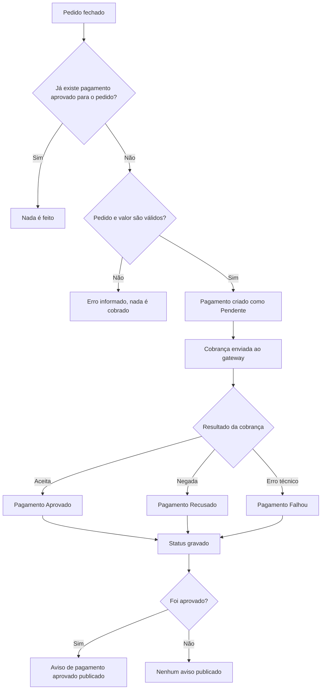

# Cobrança do Pedido Fechado

[Pagamentos](../pagamentos.md)

## Objetivo
Cobrar o valor de um pedido assim que ele é fechado e avisar quando a cobrança é aprovada.

## Diagrama

## Regras
- Pedido com pagamento já aprovado não é cobrado de novo, e nada é publicado.
- O pagamento é gravado como Pendente antes da cobrança e atualizado com o resultado.
- Cobrança negada e erro técnico são resultados do fluxo: não geram erro para quem fechou o pedido.
- O erro técnico é registrado em log com o pedido, o pagamento e a mensagem do erro.
- Só o pagamento aprovado publica o aviso, com o pedido, o pagamento e o valor cobrado.
- Pedido ou valor inválido (valor zero, por exemplo) interrompe o fluxo com erro, sem gravar nem cobrar.
- A cobrança roda dentro do fechamento do pedido: o tempo gasto no gateway conta na resposta ao cliente.
